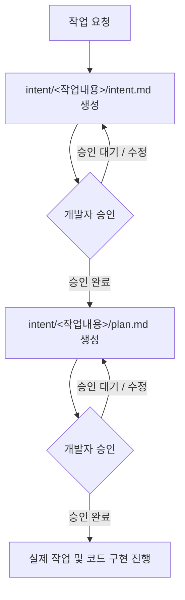

# AGENTS.md

## 1. 기본 원칙
- **언어 원칙**: 모든 답변 및 설명, 커뮤니케이션은 **무조건 한국어**로 진행합니다.
- **승인 게이트 필수 준수**: 개발자의 명시적인 승인 없이 임의로 다음 단계나 코드 구현으로 넘어가지 않습니다.

---

## 2. 작업 및 기획 워크플로우

새로운 작업 및 기획 요청이 발생하면 아래의 2단계 승인 프로세스를 반드시 순서대로 수행해야 합니다.

---

### [1단계] 작업 의도 정의 (`intent.md`)

1. **폴더 및 파일 생성**:
   - `intent/<작업내용>/` 폴더를 생성합니다.
   - 해당 폴더 내에 `intent.md` 파일을 생성합니다.

2. **작성 가이드**:
   - 개발자가 한눈에 이해하기 쉽도록 구조화하여 작성합니다.
   - **필수 포함 항목**:
     - **작업 목적**: 왜 이 작업을 수행하는가?
     - **배경 및 필요성**: 어떤 문제, 이슈, 요구사항에서 출발했는가?
     - **기대 효과 / 해결 목표**: 작업 완료 시 달성되는 구체적인 결과와 가치

3. **승인 게이트 (필수)**:
   - `intent.md` 작성을 마친 후 개발자에게 검토 및 승인을 요청합니다.
   - **개발자의 명시적인 승인이 완료되기 전에는 절대로 다음 단계(`plan.md` 작성)로 넘어가지 않습니다.**

---

### [2단계] 기획 및 계획 수립 (`plan.md`)

1. **사전 조건**:
   - 1단계 `intent.md`에 대한 개발자의 승인이 완료된 후 진행합니다.

2. **폴더 및 파일 생성**:
   - 앞서 생성한 `intent/<작업내용>/` 폴더 내에 `plan.md` 파일을 생성합니다.

3. **작성 가이드**:
   - 개발자가 보기 쉽고 실행 가능하도록 단계별로 구체화하여 작성합니다.
   - **필수 포함 항목**:
     - **세부 기획 및 기능 요구사항 명세**
     - **단계별 구현 계획 (구현 체크리스트)**
     - **영향 범위 및 고려사항** (기존 아키텍처, 의존성, 사이드 이펙트 위험 등)
     - **검증 및 테스트 계획** (작업 완료 여부를 확인할 수 있는 검증 절차)

4. **승인 게이트 (필수)**:
   - `plan.md` 작성을 마친 후 개발자에게 검토 및 승인을 요청합니다.
   - **개발자의 최종 승인이 완료되어야만 실제 코드 구현 및 후속 작업으로 넘어갑니다.**
