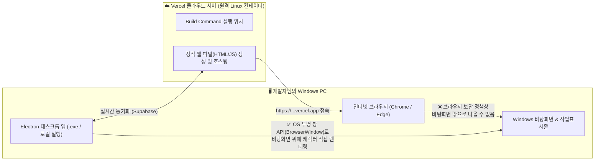

# 작업 의도 정의서 (Intent): Vercel 클라우드 빌드와 Windows 바탕화면 실행(`Electron .exe`) 구조 정립

## 1. 왜 Vercel의 Build Command에 `npm run start:electron`을 넣어도 바탕화면에 안 뜨는가?

1. **Vercel의 `Build Command`는 내 PC가 아니라 'Vercel의 원격 리눅스 서버'에서 실행됩니다**:
   - Vercel 설정의 `Build Command`에 `npm run start:electron`을 입력하면, 그 명령어는 **미국에 있는 Vercel 클라우드 서버 내부**에서 실행될 뿐 **개발자님의 Windows PC에서 실행되는 것이 아닙니다.**
2. **일반 웹 브라우저(Chrome, Edge)는 Windows 바탕화면에 투명 창을 띄울 권한이 없습니다**:
   - 크롬이나 엣지로 웹사이트(`https://*.vercel.app`)에 접속했을 때, 웹사이트가 브라우저 창 바깥인 **Windows 바탕화면이나 다른 프로그램 위에 투명 오버레이를 띄우는 것은 OS 보안상 불가능**합니다.
3. **Windows 바탕화면에 캐릭터를 띄우려면 반드시 '내 Windows PC'에서 Electron이 실행되어야 합니다**:
   - [windows.md](file:///C:/project/windows.md) 설계서와 같이, **내 PC에서 실행된 Electron 앱(또는 `.exe` 프로그램)**이 Windows OS에 투명 오버레이 창을 만들고, 데이터(로그인, 캐릭터, 채팅, 위치)는 **Supabase 클라우드 & Vercel**을 통해 실시간으로 주고받는 구조입니다.

---

## 2. 작업 목적 (Why)
1. **Vercel `Build Command` 원상 복구 (`npm run build`)**:
   - Vercel은 웹 프론트엔드와 API를 호스팅할 수 있도록 `npm run build`를 유지합니다.
2. **내 Windows PC에서 바로 실행되는 데스크톱 런처(`DeskMate.bat` / `.exe` 패키징) 및 Electron 자동 연결 구성**:
   - 개발자님의 PC에서 더블클릭 한 번(또는 터미널 명령어 한 번)으로 Electron 앱을 켜면, **Vercel에 배포된 화면(또는 로컬 빌드)을 불러와 실제 Windows 바탕화면 위에 캐릭터를 즉시 띄우도록** 구성합니다.

---

## 3. 기대 효과 및 해결 목표 (Expected Outcomes & Goals)
- **Windows 바탕화면 위 실제 캐릭터 출력 확인**: 내 PC에서 Electron 프로세스를 실행하여 작업표시줄 위 바탕화면을 돌아다니는 5종 Rive 캐릭터와 말풍선을 즉시 확인합니다.
- **원클릭 실행 파일(`run-deskmate.bat` 및 Windows `.exe` 빌드 스크립트) 제공**: 매번 복잡한 명령어를 치지 않아도 Windows에서 바로 실행할 수 있는 실행 파일과 패키징 구성을 완성합니다.
